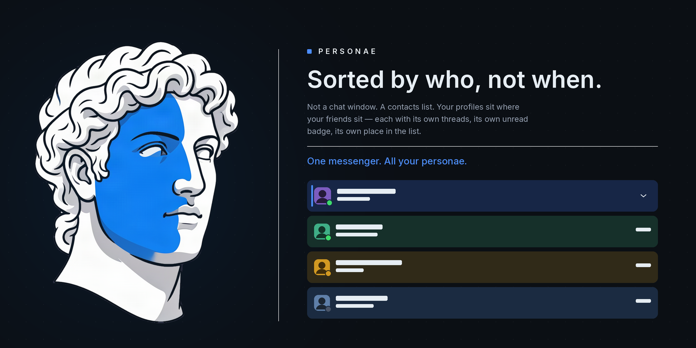

# Personae Mobile — Hermes Agent client for Android & (coming soon!) iOS

Just a simple Telegram-like Messenger that shows your profiles in a list. When you click, it expands to show all your sessions with that profile, so you can have multiple sessions with different bots, all still cleanly organised.

<a href="https://github.com/SmoothMarx/personae">Personae is also available as a Plug-in for Hermes Desktop</a>
---

## ✨ What it does

| | |
| --- | --- |
| 🟢 **Profile List** | Just like your favorite messenger app, Every profile is a contact cell with a face, a live status dot, and a "new since last visit" count. |
| 💬 **Sessions** | Upon clicking the profile you want to talk to, it expands to show all your active sessions with that profile. It has status dot to let you know their status.|
| 🕰️ **Cron Job Viewer** | A list of the cron jobs associated to that profile, with a toggle for easy on/off |
| 🖥️ **Screen Preview** | If your profile is working a browser, view it! |
| 🔌 **Welcome Wizard** | A wizard that asks **LAN** or **Remote** up front, validates IPv4 and port strictly, splits a pasted `host:port` for you, and probes every route in parallel to paint one status dot per row. Tailscale peers are listed by their MagicDNS name. |
| 🔑 **EasyPairing** | The app opens your dashboard at `next=/pair`, polls, then redeems a single-use code. The phone ends up with its **own device token** — revocable on its own, never your bearer. |
| 🗂️ **Groups** | Named sections shared by both panes; an empty one explains how to fill it |
| 🌱 **Apropos** *(beta)* | A fresh session that already knows the background of the ones you picked |


---

## 🚀 Quick Start

### Android — the release APK

Download `personae-<version>.apk` from [Releases](../../releases), copy it to the phone, and open it
(allow "install unknown apps" for the file manager that opened it). Then:

**Connect** → pick **LAN** or **Remote** → enter the gateway address → it probes and tells you what it
found.

### From source, on a phone

```
npm install
npm run mock              # a mock gateway on 127.0.0.1:8791, key "test-key-123"
npx expo start            # then open it in Expo Go, or `npx expo run:android`
```

Point the app at the mock (`http://<your-lan-ip>:8791`, key `test-key-123`) to exercise the roster, the
thread, streaming, Stop and every error path without touching a real gateway.

### Against your own gateway

The app speaks to the gateway host directly. Put the phone on the same LAN, or on your Tailscale
network and use the tailnet address. A real gateway on a LAN answers on its own port; a remote one
usually wants the dashboard's `/pair` flow.

---

## 🧠 The story

Just a simple Telegram-like Messenger that shows your profiles in a list. When you click, it expands to show all your sessions with that profile, so you can have multiple sessions with different bots, all still cleanly organised.
---

## 🔌 Connecting

The wizard asks one question before it shows a single field — **LAN or Remote** — because the two want
different inputs and different proof.

- **LAN** — strict IPv4 and a separate port. A pasted `http://host:port/path` is split into its parts.
- **Remote** — Tailscale peers listed by MagicDNS name, or the address typed by hand.

Every route gets its own probe, run in parallel, with no repeating timer: one probe per row, one dot
per row. The wizard remembers what you skipped.

---

## 🔑 Pairing

A phone should never carry your bearer token. The dashboard side ships two Hermes plugins
(`server/personae-mobile-auth`, `server/personae-mobile-state`) and they exist to prevent exactly that:

- the app opens the dashboard at `next=/pair`, then **polls**, then **redeems** — three staged calls,
  and a 401 anywhere means sign in again;
- a code is a credential on the redeem path **only**, single use, rate-limited per IP, capped in number,
  and minted under an entropy gate;
- what the phone keeps is a device token it can revoke on its own, and which cannot administer anything;
- the token store is `0600`, holds no plaintext, and fails closed on corruption rather than guessing.

---

## ⚙️ Settings and preferences

Gateway, key, extra profiles and model override — each field saves itself, and the value in use is the
value on screen.

Portable preferences sync through the state plugin with per-key last-write-wins and a monotonic
revision, so two devices editing **different** keys both survive, and a stale revision never clobbers a
newer one. Device-local keys are refused with a reason instead of being quietly synced.

---

## 🛡️ Safety

- **No secret is in this repository.** `scripts/verify-secrets.sh` greps every tracked file *and* every
  untracked-but-not-ignored file for the live credentials and prints **counts only** — never a matched
  value. If it cannot read the live bearer it reports `SKIPPED` rather than claiming a pass.
- **No credential is compiled into the build.** The API key lives in the OS secure store on the device,
  not in a file in the tree.
- **No analytics.** There is no analytics or crash-reporting dependency in `package.json`. The only
  network peer is the gateway address you typed.
- **The support bundle is masked before it leaves.** Addresses keep three octets, and headers, tickets
  and tokens are redacted by pattern — not only by value, so a token you never enumerated is still
  caught.
- **`logs/` is the app's own evidence.** The per-version transcripts there are the output of the leak
  checks, kept so a claim can be re-run instead of re-asserted.
- **The Android build asks for little:** `INTERNET`, `POST_NOTIFICATIONS`, `RECORD_AUDIO` (for the voice
  composer) and local-network access. `NSAllowsLocalNetworking` is set on iOS for the same reason.

---

## 📦 Project layout

```
app/            # expo-router routes — roster, thread/[id], settings, connect
src/api/        # client, transport (XHR + node), SSE parser, error shapes, failures
src/logic/      # pure derivations — roster, thread, markdown, scroll pin, slash, voice
src/connect/    # the wizard, address parsing, staged probes, the support bundle
src/gateway/    # connections, routes, per-route status dots, the plan
src/roster/     # roster UI — cells, geometry, sheets, menus
src/sync/       # preference + UI-state sync against the state plugin
src/            # settings model + secure storage, i18n, theme, notifications
modules/        # tailscale-trigger — a local Expo module that calls the Tailscale app forward
mock/           # local Node mock of the gateway API (also runnable standalone)
server/         # the two Hermes dashboard plugins the app pairs against
scripts/        # signing + branding patches, and the secret scanners
tests/          # the offline suite (`npm test`)
logs/           # per-version verification transcripts — the leak checks, run by script
brand/          # the logo kit, the cover banner and the design exploration
assets/         # app icon, adaptive icon, splash screens (five densities)
app.json        # Expo config — name, icons, Android permissions, iOS local networking
eas.json        # build profiles
package.json    # scripts and dependencies
tsconfig.json   # strict TypeScript
LICENSE         # GPL-3.0
README.md       # this file
```

The repository also carries its working record — `PROGRESS.md`, `DECISIONS.md`, `QUESTIONS.md`,
`SPEC.md`, `RECON-0.9.0.md` and the `GOAL-*` / `DESIGN-*` briefs. They are the project's own history,
kept because "verified" without a record is just a claim.

---

## 🔧 Development

```
npm install
npm test                 # 324 offline checks against the mock gateway — no key needed
npm run typecheck        # tsc --noEmit
bash server/run-tests.sh # 77 pytest checks on the QR / pairing / tailscale / state server helpers
npm run mock             # mock gateway on 127.0.0.1:8791, key "test-key-123"
npx expo start           # Expo Go, or `npx expo run:android`
```

Tested on **Node 22**. Written in strict TypeScript; `npm run typecheck` is expected to be silent.

The server suite is a separate runner and needs no install: `server/run-tests.sh` borrows `pytest` from a
sibling venv and puts it on a throwaway `sys.path`, so nothing is added to any environment.

Three rules worth keeping if you fork:

1. **Run the secret scan before you push.** `bash scripts/verify-secrets.sh`.
2. **Some checks read the source as text** — a rename can go red without anything being broken. When a
   check about *shape* fails, read it before you "fix" the code it names.
3. **`0.14.0 W1` (the cold-resume/lease check) is intermittently red.** It is a pre-existing flake in the
   harness, present before this tree was published, and it is not a build failure. Measured over four
   runs each: **2 of 4 red on the original, 1 of 4 on this one** — the same check at a comparable rate,
   which is how you can tell the rewrite did not cause it. Everything else is expected green.

`android/` is generated and git-ignored, so rebuilds re-apply the signing patch by script:

```
npx expo prebuild -p android --no-install
bash scripts/patch-android-signing.sh
```

The release keystore lives **outside** this repository. Keep it: a build signed with a different key
cannot upgrade an installed copy — Android refuses, and the app must be uninstalled first.

---

## 🙏 Acknowledgements

Stands on the shoulders of:

- [Hermes Agent](https://github.com/NousResearch/hermes-agent) by Nous Research — the agent and the
  gateway API this app is a client for; every request and response shape is derived from its
  `gateway/platforms/api_server.py`, with the line numbers cited in `src/api/client.ts`.
- [Expo](https://expo.dev) and [expo-router](https://docs.expo.dev/router/introduction/) — the build
  toolchain and the file-based navigation.
- [React Native](https://reactnative.dev) — the renderer.
- [react-native-sse](https://github.com/binaryminds/react-native-sse) — event-stream parsing over XHR.
- [remark](https://github.com/remarkjs/remark) and [unified](https://github.com/unifiedjs/unified) with
  `remark-gfm` — the markdown parse that feeds the renderer.

---

*GPL-3.0. Free to use, modify and share.*
